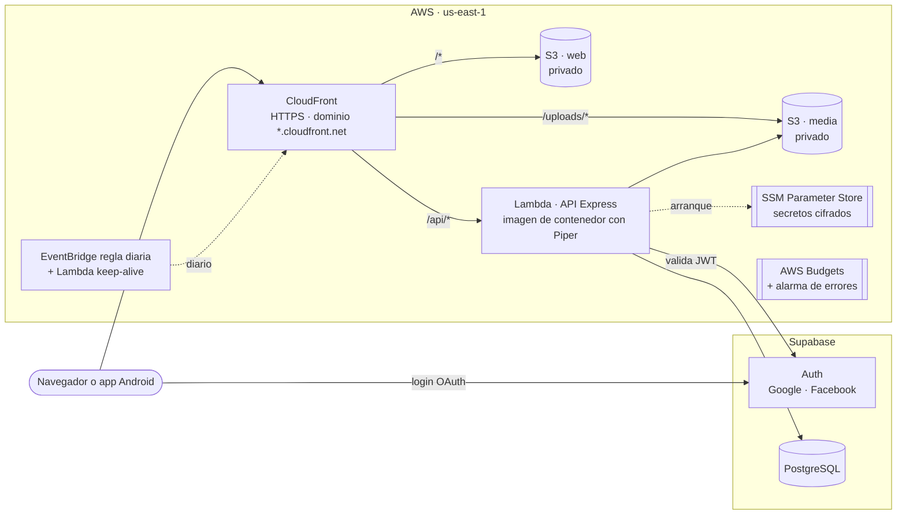

# Despliegue en AWS

Cómo se despliega LexFlow (esta API y [lexflow-web](https://github.com/dimasjavier0/lexflow-web)) en AWS, por qué se eligió cada pieza, qué cuesta, cómo se protege y los pasos para levantarla, actualizarla, vigilarla y retirarla.

Este documento no contiene datos privilegiados: ni identificadores de cuenta, ni claves, ni correos, ni contraseñas. Donde hacen falta aparecen como `<marcador>` y su valor real vive en SSM Parameter Store, en los *secrets* de GitHub o en la consola de cada servicio.

## Objetivos y restricciones

- **Nada en local.** La web, la API, la base de datos y los archivos (imágenes y audios) quedan en la nube. Ningún servicio depende del ordenador de desarrollo.
- **Coste casi cero y sostenido.** La cuenta usa el plan gratuito de AWS con créditos durante 6 meses; después debe seguir costando céntimos al mes. Por eso no se usa nada con coste mínimo mensual: ni NAT Gateway, ni RDS, ni balanceadores, ni IPv4 pública en EC2, ni Secrets Manager.
- **Evidencia de portfolio.** La infraestructura es código (AWS CDK en TypeScript, en `infra/`), se despliega con GitHub Actions y la app queda en línea en una URL pública.
- **Sin datos personales expuestos.** A la nube solo sube el contenido educativo (colecciones, palabras y sus recursos). Las cuentas, el progreso y las amistades de desarrollo no se migran.

## Arquitectura



Todo se sirve desde un único dominio de CloudFront, así que la web llama a la API con rutas relativas (`/api/...`) y no hace falta CORS entre orígenes.

| Ruta en CloudFront | Origen                       | Caché                                   |
| ------------------ | ---------------------------- | --------------------------------------- |
| `/*` (por defecto) | Bucket `web`, con OAC        | `assets/*` un año; `index.html`, `sw.js` y el manifest sin caché |
| `/uploads/*`       | Bucket `media`, con OAC      | Larga: cada archivo tiene un nombre único |
| `/api/*`           | Function URL de la Lambda    | Desactivada; una CloudFront Function quita el prefijo `/api` y añade `x-public-origin` |

Las rutas de la SPA (`/profile`, `/learn/...`) las resuelve otra CloudFront Function que sirve `index.html` cuando la ruta no tiene extensión.

## Recursos y por qué

| Recurso | Para qué | Por qué este y no otro | Coste estimado |
| ------- | -------- | ---------------------- | -------------- |
| **CloudFront** (1 distribución) | HTTPS, dominio público, caché y punto único de entrada | Capa gratuita permanente: 1 TB y 10 M de peticiones al mes. Da HTTPS sin comprar dominio. | $0 |
| **S3 `web`** | Archivos compilados de la web | Bucket privado leído solo por CloudFront (OAC). | Céntimos (< 5 MB) |
| **S3 `media`** | Imágenes y audios (`uploads/`) | Sustituye a la carpeta local `uploads/`. Privado, cifrado (SSE-S3), solo TLS. Se conserva si se borra el stack. | Céntimos (~40 MB) |
| **Lambda** (imagen de contenedor, x86_64, 1 GB) | La API Express sin cambios, con [Lambda Web Adapter](https://github.com/awslabs/aws-lambda-web-adapter) | Capa gratuita permanente (1 M de peticiones y 400 000 GB-s al mes). Contenedor porque Piper (binario + voces, ~150 MB) no cabe en un ZIP. Sin VPC: así no necesita NAT. | $0 |
| **Function URL** (respuesta en *streaming*) | Puerta de la Lambda para CloudFront | Gratis, a diferencia de API Gateway tras su primer año. El *streaming* mantiene vivas las barras de progreso NDJSON del panel admin. | $0 |
| **ECR** (repositorio de assets de CDK) | Imagen de la Lambda | El que crea `cdk bootstrap`. `cdk gc` borra imágenes viejas. | ~$0.05/mes |
| **SSM Parameter Store** (SecureString, nivel estándar) | Secretos de la API | Gratis con la clave de KMS administrada por AWS. Secrets Manager cuesta $0.40 por secreto al mes. | $0 |
| **Regla diaria de EventBridge + Lambda keep-alive** | Una petición diaria a `/api/collections`, que consulta la base | Supabase pausa los proyectos gratuitos tras 7 días sin actividad. | $0 |
| **CloudWatch Logs** (retención 14 días) + **1 alarma** de errores con **SNS** por correo | Diagnóstico y aviso | Dentro de la capa gratuita permanente (5 GB de logs, 10 alarmas, 1000 correos). | $0 |
| **AWS Budgets** | Aviso por correo si el gasto previsto pasa de $1 al mes | Los dos primeros presupuestos son gratis. | $0 |
| **IAM**: proveedor OIDC de GitHub y roles de despliegue | GitHub Actions despliega sin claves de acceso | Credenciales temporales por ejecución, limitadas a la rama `main` de cada repositorio. | $0 |
| **Supabase** (fuera de AWS) | Auth (ya existía) y PostgreSQL | No hay PostgreSQL gestionado gratis en AWS a largo plazo; RDS cuesta ~$15/mes tras el primer año. | $0 (plan gratuito: 500 MB) |

**Total estimado: $0.10–0.50 al mes**, casi todo almacenamiento. Región `us-east-1` (la más barata, y la única donde CloudFront acepta certificados de ACM si algún día se añade un dominio propio).

### Lo que se descartó

- **EC2 con todo dentro**: ~$8–10/mes (instancia, disco e IPv4 pública) y mantenimiento del sistema operativo.
- **EC2/ECS + RDS**: ~$20–25/mes; agota los créditos antes de los 6 meses.
- **Lambda dentro de una VPC con RDS**: exige NAT Gateway (~$32/mes) para salir a Pixabay, Supabase y Facebook.
- **API Gateway**: gratis solo el primer año; la Function URL hace lo mismo aquí.
- **«Launch with AWS»**: reescribe la app hacia Cognito y Aurora/DynamoDB y no migra datos.

## Seguridad

- **Secretos**: `DATABASE_URL`, `SUPABASE_SERVICE_ROLE_KEY`, `FACEBOOK_APP_SECRET`, `PIXABAY_API_KEY`, `PEXELS_API_KEY` y `YOUTUBE_API_KEY` son parámetros *SecureString* bajo `/lexflow/prod/`. La Lambda los lee al arrancar (`GetParametersByPath` con descifrado, `src/lib/load-secrets.ts`) y solo tiene permiso sobre esa ruta. Nunca están en el repositorio, en variables de entorno de la Lambda ni en la plantilla de CloudFormation. Se cargan a mano con `aws ssm put-parameter` (ver [Paso 4](#4-cargar-los-secretos)).
- **`ORIGIN_VERIFY_SECRET`** vive en la misma ruta pero como parámetro *String*: CloudFormation tiene que leerlo para configurar la cabecera de CloudFront, y no admite *SecureString* ahí. Es un valor aleatorio sin otro uso, visible solo para quien tenga acceso a la cuenta.
- **Configuración no secreta** (URL de Supabase, nombre del bucket, URL pública): variables de entorno de la Lambda, definidas en CDK.
- **Buckets privados**: *Block Public Access* activado, cifrado SSE-S3, solo TLS, lectura únicamente desde CloudFront con *Origin Access Control*.
- **La API solo responde a CloudFront**: CloudFront añade la cabecera `x-origin-verify` con un valor aleatorio que también conoce la API (`ORIGIN_VERIFY_SECRET`); las peticiones directas a la Function URL sin ella reciben 403.
- **IP real del cliente**: Express confía en los saltos de CloudFront y Function URL (`TRUST_PROXY_HOPS`), así el límite de peticiones por IP sigue funcionando.
- **CORS** cerrado (`CORS_ORIGINS=none`): la web y la API comparten dominio, así que ningún otro origen necesita acceso.
- **URL de los archivos**: la Lambda no conoce el dominio de CloudFront al crearse (sería una dependencia circular), así que la CloudFront Function de `/api/*` lo envía en `x-public-origin`. La API solo se fía de esa cabecera cuando `x-origin-verify` es correcta.
- **Cabeceras de seguridad** en CloudFront: HSTS, `X-Content-Type-Options`, `Referrer-Policy` y `X-Frame-Options`.
- **Despliegue sin claves**: GitHub Actions asume roles por OIDC. El ARN del rol se guarda como *secret* del repositorio, así el identificador de la cuenta no aparece en el código ni en los logs públicos.
- **Cuenta**: el trabajo diario se hace con un usuario con MFA, no con el usuario raíz. El raíz también tiene MFA.
- **Datos**: a Supabase solo se copian las tablas de contenido. El primer inicio de sesión en producción crea la cuenta de cero.

## Datos

| Tabla | ¿Se migra? |
| ----- | ---------- |
| `Collection`, `Word`, `CollectionWord`, `Image`, `Audio`, `Video`, `ExampleSentence`, `WordRelationship` | Sí |
| `User`, `UserWordProgress`, `UserDailyPoints`, `Friendship` | No: son datos personales de desarrollo |

- El esquema se crea en Supabase con `prisma migrate deploy` (mismas migraciones que en local).
- Los datos se exportan del PostgreSQL local con `pg_dump --data-only` de esas tablas y se importan en Supabase.
- Las URL guardadas como `http://localhost:3000/uploads/...` se reescriben a `https://<dominio-cloudfront>/uploads/...`.
- La carpeta `uploads/` se sube al bucket `media` con `aws s3 sync`, bajo el prefijo `uploads/`, así las rutas no cambian.
- La API compone las URL nuevas con `PUBLIC_BASE_URL` (el dominio de CloudFront) en lugar del `Host` de la petición.

## Cambios en el código

- **API**:
  - Almacén de archivos con dos implementaciones: disco local en desarrollo y S3 cuando existe `MEDIA_BUCKET`.
  - `x-public-origin` (o `PUBLIC_BASE_URL`), `TRUST_PROXY_HOPS`, `CORS_ORIGINS=none` y la comprobación de `x-origin-verify`.
  - `prisma.config.ts` deja que un `DATABASE_URL` puesto en la terminal gane al de `.env`, para que las migraciones lleguen a producción.
  - El cliente de Prisma se genera con imports `.js`, que necesita Node al ejecutar el build compilado.
  - Cargador de secretos desde SSM.
  - `Dockerfile` para Lambda con Piper para Linux y las dos voces en uso.
- **Web**: `VITE_API_URL=/api`. Nada más.
- **Infraestructura**: app de CDK en `infra/` y flujos de GitHub Actions en los dos repositorios.

## Pasos

Cada paso indica quién lo hace. Los comandos se ejecutan desde la raíz de `lexflow-api` salvo que se diga otra cosa.

### 1. Preparar la cuenta (propietario)

1. Activar MFA en el usuario raíz y crear un usuario de trabajo con MFA (IAM Identity Center o IAM).
2. Instalar AWS CLI v2 (2.32 o superior, por `aws login`) e iniciar sesión:

   ```bash
   aws login --region us-east-1
   aws sts get-caller-identity   # debe mostrar el usuario de trabajo, no el raíz
   ```

### 2. Preparar Supabase (propietario)

1. En el proyecto de Supabase, **Project Settings → Database**: anotar la cadena de conexión del *pooler* en modo transacción (puerto 6543, para la Lambda) y en modo sesión (puerto 5432, para las migraciones).
2. **Authentication → URL Configuration**: *Site URL* `https://<dominio-cloudfront>` y *Redirect URLs* `https://<dominio-cloudfront>/**` (se completa tras el paso 5).
3. En Facebook (**App settings → Basic**), añadir el dominio a *App Domains* y las URL de `/privacy` y `/delete-account`.

### 3. Arrancar CDK (una vez por cuenta y región)

```bash
cd infra
npm ci
npx cdk bootstrap
```

### 4. Cargar los secretos

Cada secreto se guarda con `infra/scripts/set-secret.ps1`, que lo pide sin mostrarlo en pantalla ni dejarlo en el historial:

```powershell
.\infra\scripts\set-secret.ps1 DATABASE_URL               # pooler de Supabase en modo transacción (6543)
.\infra\scripts\set-secret.ps1 SUPABASE_SERVICE_ROLE_KEY  # para «Eliminar mi cuenta»
.\infra\scripts\set-secret.ps1 SUPABASE_JWT_SECRET        # solo proyectos que aún firman con HS256
.\infra\scripts\set-secret.ps1 PIXABAY_API_KEY
.\infra\scripts\set-secret.ps1 FACEBOOK_APP_SECRET        # opcional: amigos de Facebook
.\infra\scripts\set-secret.ps1 PEXELS_API_KEY             # opcional
.\infra\scripts\set-secret.ps1 YOUTUBE_API_KEY            # opcional
```

`DATABASE_URL` es la cadena del *Transaction pooler* de Supabase (botón **Connect** del proyecto) con la contraseña de la base y, al final, `?sslmode=require&uselibpqcompat=true`: cifra la conexión como lo hace `libpq`, sin exigir la CA propia de Supabase.

El secreto que CloudFront envía a la API se genera aleatorio y nunca se escribe a mano:

```bash
aws ssm put-parameter --type String --name /lexflow/prod/ORIGIN_VERIFY_SECRET --value "$(openssl rand -hex 32)"
```

Para rotar un secreto: volver a ejecutar el script (sobrescribe) y forzar un arranque nuevo de la Lambda (otro despliegue). En Git Bash, los comandos `aws` con rutas `/lexflow/...` necesitan `MSYS_NO_PATHCONV=1`, porque Git Bash las convierte en rutas de Windows.

### 5. Desplegar la infraestructura

```bash
cd infra
SUPABASE_URL='https://<proyecto>.supabase.co' ALERT_EMAIL='<correo>' npx cdk deploy
```

`SUPABASE_URL` es la URL pública del proyecto (la API valida los inicios de sesión contra ella). `ALERT_EMAIL` solo se usa para el presupuesto y la alarma. Ninguno de los dos se guarda en el repositorio. Las salidas (`Outputs`) dan el dominio de CloudFront, los buckets y el id de la distribución. Hay que confirmar la suscripción de SNS desde el correo.

### 6. Migrar los datos (una vez)

Con el PostgreSQL local todavía en marcha:

1. `DATABASE_URL='<cadena-del-pooler-5432>' npx prisma migrate deploy` crea el esquema en Supabase.
2. `TARGET_DATABASE_URL='<cadena-del-pooler-5432>' PUBLIC_URL='https://<dominio-cloudfront>' infra/scripts/migrate-content.sh` exporta las tablas de contenido, las importa en Supabase en una sola transacción y reescribe las URL. Al final muestra los recuentos: debe haber 0 usuarios y 0 URL locales.
3. `aws s3 sync uploads/ s3://<bucket-media>/uploads/` sube los archivos.
4. Iniciar sesión en la web publicada y dar el rol de administrador desde el editor SQL de Supabase: `update "User" set role = 'ADMIN' where email = '<correo>';`

### 7. Desplegar la web

La hace el flujo de GitHub Actions de lexflow-web (`npm run build` con `VITE_API_URL=/api`, `aws s3 sync` al bucket `web` e invalidación de CloudFront). A mano:

```bash
# En lexflow-web
VITE_API_URL=/api npm run build
aws s3 sync dist/ s3://<bucket-web>/ --delete
aws cloudfront create-invalidation --distribution-id <id> --paths '/index.html' '/sw.js' '/manifest.webmanifest'
```

### 8. Automatizar (GitHub Actions)

Los flujos están en `.github/workflows/deploy.yml` de cada repositorio. El rol se asume por OIDC y `mask-aws-account-id` oculta el número de cuenta en los logs.

| Repositorio | Disparador | Qué hace | Secrets y variables |
| ----------- | ---------- | -------- | ------------------- |
| lexflow-api | push a `main` (y comprobación en cada pull request) | `npm run check`, `prisma migrate deploy` si existe `MIGRATION_DATABASE_URL`, `cdk deploy` (construye la imagen) | Secrets `AWS_DEPLOY_ROLE_ARN`, `ALERT_EMAIL`, `MIGRATION_DATABASE_URL` (opcional); variable `SUPABASE_URL` |
| lexflow-web | push a `main` | `npm run check`, build, sync a S3, invalidación | `AWS_WEB_DEPLOY_ROLE_ARN`; variables `WEB_BUCKET`, `DISTRIBUTION_ID`, `VITE_SUPABASE_URL`, `VITE_SUPABASE_ANON_KEY` |

### 9. Verificar

- La web carga en `https://<dominio-cloudfront>` en escritorio y a 390 px.
- Login con Google y Facebook, lección, repaso, «Mi progreso», amigos y «Eliminar mi cuenta».
- Panel admin: subir una imagen, buscar en Pixabay y generar pronunciación con Piper.
- `https://<function-url>/collections` sin la cabecera responde 403.
- La consola de facturación no muestra gasto fuera de lo previsto.

### 10. Retirar lo local (propietario, solo tras verificar)

Detener y borrar el contenedor y el volumen de PostgreSQL local y la carpeta `uploads/`, una vez comprobado que todo está en la nube.

## Seguimiento

| Fase | Estado |
| ---- | ------ |
| Documento de infraestructura | Hecho |
| 1. Cuenta, CLI y MFA | Pendiente |
| 2. Supabase | Pendiente |
| 3–5. CDK, secretos e infraestructura | Pendiente |
| 6. Migración de datos | Pendiente |
| 7. Web publicada | Pendiente |
| 8. GitHub Actions | Pendiente |
| 9. Verificación | Pendiente |
| 10. Retirada de lo local | Pendiente |

### Revisión periódica (mensual)

- **Facturación → Bills y Free Tier**: el gasto debe seguir en céntimos y ningún servicio cerca de su límite gratuito.
- **CloudWatch → Logs** de la Lambda: errores repetidos o arranques en frío largos.
- **Supabase → Usage**: tamaño de la base (límite de 500 MB) y que el proyecto no esté pausado.
- **ECR**: las imágenes antiguas se acumulan en el repositorio de assets de CDK; `cd infra && npx cdk gc --unstable=gc` borra las que ya no se usan.
- **Créditos**: al acercarse el fin de los 6 meses, pasar la cuenta al plan de pago para que no se cierre. Con este diseño el coste sigue casi en cero.

### Retirar el despliegue

```bash
cd infra && npx cdk destroy
```

Los buckets se conservan a propósito (`RETAIN`): para borrarlos, vaciarlos y eliminarlos desde la consola de S3. Después borrar los parámetros `/lexflow/prod/*` de SSM y, si no queda nada más con CDK, el stack `CDKToolkit`.
